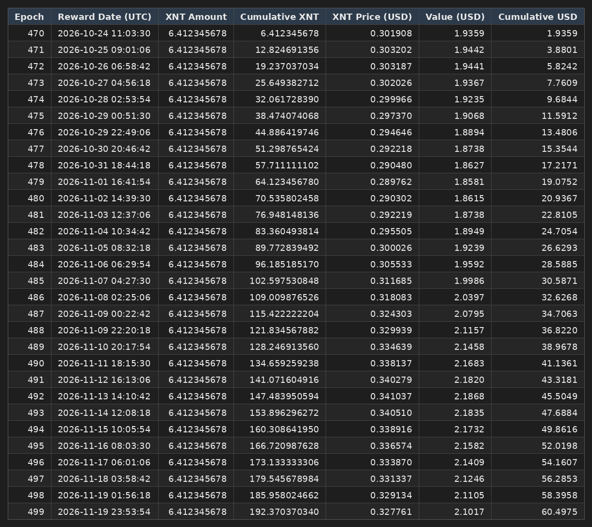
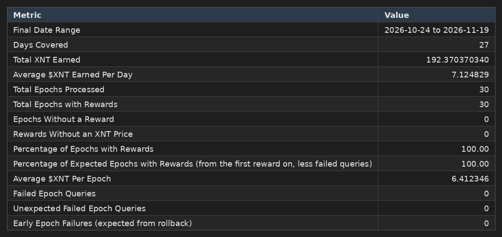

# X1 Blockchain Validator Analytics


[](https://github.com/nottoseethesun/x1-validator-analytics/actions/workflows/ci.yml)
[](https://github.com/nottoseethesun/x1-validator-analytics/actions/workflows/ci.yml)
[](https://github.com/nottoseethesun/x1-validator-analytics/actions/workflows/security-audit.yml)

## Overview

A script that reads what an X1 validator has earned: every inflation
reward its vote account received, each priced in USD at its own time,
written to a CSV file with running totals, and a summary to a second
file. X1 is a blockchain built from Solana's code, and XNT its coin.

The script, `fetch-total-validator-earnings.js`, runs on Node, the
program that runs JavaScript outside a browser. It asks an X1 rpc
endpoint, the json-rpc api of an X1 node, for each epoch's reward and the
time of the block that paid it, and GeckoTerminal, a service that lists
the pools of decentralized exchanges with their prices and candles, for
XNT's price at that hour. The repo's owner, nottoseethesun on GitHub,
uses it for his own validator's books.

### Prices

Each reward is priced from GeckoTerminal's hourly candles for one pool
of XDEX, a decentralized exchange on X1: WXNT, wrapped XNT, against
USDC.X, a USD stablecoin taken at $1. The price is the close of the last
candle that opened at or before the reward, less than a day before it.
GeckoTerminal's X1 candles start on 2026-10-01, and its public api serves
the last 180 days, so a reward before either has empty price and value
cells, with a warning. Amounts keep all nine of XNT's decimal places.

## Table of Contents

- [Overview](#overview)
  - [Prices](#prices)
- [Disclaimer](#disclaimer)
- [Screenshot](#screenshot)
- [Prerequisites](#prerequisites)
- [Install](#install)
  - [Api Keys](#api-keys)
- [Optional: Verify Download](#optional-verify-download)
- [Update](#update)
  - [Versions of crypto-price-fetchers](#versions-of-crypto-price-fetchers)
- [Uninstall](#uninstall)
- [Usage](#usage)
  - [A Validator's Rewards](#a-validators-rewards)
- [Configure](#configure)
- [Lint & Test](#lint--test)
- [Private Key Security](#private-key-security)
- [Development](#development)
  - [Architecture and Engineering References](#architecture-and-engineering-references)
- [License](#license)
- [Road Map](#road-map)
- [Donations](#donations)
- [Contributing](#contributing)

---

## Disclaimer

USE AT YOUR OWN RISK: this software is provided "as is", without warranty
of any kind, as its [license](LICENSE) says. It has not been formally
audited and may contain bugs. Its figures come from an X1 rpc endpoint
and from GeckoTerminal, which can be wrong, late or missing: check them
before you rely on them, for your taxes or for anything else.

---

## Screenshot

The two CSV files a run writes, opened in Google Sheets, Google's
spreadsheet app: the rewards, each with its price and the running totals,
and the summary. The pictures come from an older version, which priced
every reward at 1; the script now leaves a reward before 2026-10-01
unpriced and prices the rest from the pool, as [Prices](#prices) says,
and its summary's labels have changed.




---

## Prerequisites

- A terminal.
- Node 24 or later, from [nodejs.org](https://nodejs.org/), with npm, the
  package manager that comes with it, which installs a project's packages
  and runs the commands its `package.json` names. The repo is tested on
  Node 24 and 26.
- git, the version-control program, to clone the repo from GitHub, the
  website that hosts it.
- The public key of the validator's vote account.

---

## Install

Clone the repo, then, from its top folder, install the packages
`package.json` lists, at the versions `package-lock.json` keeps:

```bash
git clone https://github.com/nottoseethesun/x1-validator-analytics.git
cd x1-validator-analytics
npm ci
```

It installs everything the script needs, including, from GitHub,
crypto-price-fetchers, the owner's repo of code his projects share: its
key store, and its GeckoTerminal client, which prices XNT.

### Api Keys

The script sends no api key today: GeckoTerminal and the X1 endpoint take
none. Should a service that takes one be added, its key is kept in
`api-keys.json` here, which git ignores, encrypted with a password you
choose, by crypto-price-fetchers' key store, which keeps keys as LP Ranger,
the owner's bot that manages his 9mm V3 liquidity positions, keeps its own.
The top `config.json` lists the services under `apiKeys`; this repo's
`npm run api-keys` runs the store's key manager, which lists their keys,
never showing their characters, and saves each one asked for; and
`source ./unlock-api-keys.sh`, a script in the repo's top folder, keeps the
password for a terminal. A key is never a setting in a file, nor a
command-line argument.

---

## Optional: Verify Download

Shows that your clone is at the commit GitHub has, and that the packages
npm installed are the ones the lockfile names.

git names each commit by a hash of its files and its history, so a
commit's name changes when any of its files does, and two clones at
commits of the same name hold the same files. From the repo's top folder,
these print the commit you have and the commit GitHub has for `main`; the
same 40 characters in both mean you hold the code GitHub holds:

```bash
git rev-parse HEAD
git ls-remote https://github.com/nottoseethesun/x1-validator-analytics.git main
```

`npm ci` checks every package it downloads from npm's registry against
the hash `package-lock.json` keeps for it, its `integrity`, and stops when
one differs. crypto-price-fetchers comes from GitHub instead, at the
commit the lockfile names. actionlint, the checker of GitHub Actions
workflow files that the lint runs, is downloaded by crypto-price-fetchers'
bin `run-actionlint`, which refuses it unless its SHA-256 is the one that
repo pins.

---

## Update

From the repo's top folder, take the newest commit of `main`, then install
the packages its lockfile names:

```bash
git pull
npm ci
```

A `config.json` you changed is a file git keeps: when a newer commit
changes it too, `git pull` stops rather than write over your change, and
`git stash`, then `git pull`, then `git stash pop` carries your change
across.

### Versions of crypto-price-fetchers

crypto-price-fetchers is installed straight from its GitHub project,
rather than from npm's registry, at the commit the lockfile names, so
this step is optional. `package.json` names it with a ref:
`#main`, its main branch, which this repo follows, or `#semver:*`, its
latest release, its highest version tag. `package-lock.json` keeps the
commit the ref named when the lockfile was made, and `npm ci` installs
that commit.

crypto-price-fetchers also holds the tool that moves it: its versions
tool, which this repo runs as `npm run github-project-deps`. It sets the
ref, then makes `package-lock.json` again from a fresh `node_modules`. If
the install fails, `package.json` and `package-lock.json` go back as they
were, and `node_modules` is installed again from them. The newest commit
of main:

```bash
npm run github-project-deps -- main
```

The latest release:

```bash
npm run github-project-deps -- release
```

No release can be installed yet: every release of crypto-price-fetchers,
the newest being 1.3.0, came before its `package.json`, so `release`
fails, and the files go back as they were. It works once a release with a
`package.json` is tagged.

---

## Uninstall

From the folder that holds it, delete the repo's folder, and with it the
files the runs wrote there:

```bash
rm -rf x1-validator-analytics
```

---

## Usage

The script's command line answers `--help` with every option, examples
of its common uses and its exit codes, and
[`docs/project-commands.md`](docs/project-commands.md) lists every
command with its flags. Run the commands from the repo's top folder;
`<vote-account>` stands for the vote account's public key.

### A Validator's Rewards

A run needs only the vote account's public key. It writes the rewards to
`xnt_rewards_with_prices.csv`, unless `--output` or `config.json` names
another file, and the summary to `xnt_rewards_analytics.csv`, always by
that name, in the folder it runs in.

Every reward of a vote account, from its first epoch to the last one
completed:

```bash
node fetch-total-validator-earnings.js --vote-pubkey <vote-account>
```

The last 20 epochs only, with each step logged:

```bash
node fetch-total-validator-earnings.js --vote-pubkey <vote-account> --epochs 20 --verbose
```

Every reward, with JSON files too, in the folder it runs in: all of it in
`xnt_rewards.json`, and the summary in `xnt_rewards_analytics.json`:

```bash
node fetch-total-validator-earnings.js --vote-pubkey <vote-account> --json
```

`npm start -- <options>` runs the same command line.

---

## Configure

The script runs as it comes. Its settings are `config.json`, in the folder
it runs in, over the defaults written in `configLoader.js`; a folder
without one gives those defaults, with a notice. The file is checked
against its JSON Schema, a description of the keys the file may hold and
the kind of value each takes, before the script takes any setting: a key
the script does not read, or a value of the wrong kind, stops the run,
with every problem listed, one line each.

A token on X1 is named by its mint, the address of the account that
issues it, as on Solana.

| Setting | What it sets | Default | Option that overrides it |
| ------- | ------------ | ------- | ------------------------ |
| `rpcUrl` | the X1 rpc endpoint to ask | `https://rpc.mainnet.x1.xyz` | `--rpc-url` |
| `requestTimeoutSeconds` | how long each request to the X1 endpoint may take, its whole answer included: a whole number of seconds from 1 to 2147483, the longest time limit Node's timers keep | 30 | — |
| `liquidityPoolAddress` | the pool whose hourly candles on GeckoTerminal price XNT | XDEX's WXNT / USDC.X, `CAJeVEoSm1QQZccnCqYu9cnNF7TTD2fcUA3E5HQoxRvR` | `--liquidity-pool-address` |
| `xntTokenAddress` | the mint of wrapped XNT, one side of that pool | `So11111111111111111111111111111111111111112` | — |
| `usdStablecoinAddress` | the mint of the USD stablecoin on the pool's other side | USDC.X, `B69chRzqzDCmdB5WYB8NRu5Yv5ZA95ABiZcdzCgGm9Tq` | — |
| `geckoTerminalApiUrl` | GeckoTerminal's api address | `https://api.geckoterminal.com/api/v2` | — |
| `geckoTerminalNetwork` | GeckoTerminal's name for X1 | `x1-network` | — |
| `outputFile` | the main CSV file to write | `xnt_rewards_with_prices.csv` | `--output` |
| `verbose` | whether to log each step | `false` | `--verbose` |
| `epochs` | how many epochs to read, back from the last one completed; every epoch when `null` | `null` | `--epochs` |
| `apiKeys` | the services whose keys the key store keeps | none | — |

---

## Lint & Test

The gate, LP Ranger's, runs the lint, the tests and the security audits,
and must pass before every commit and push. The lint runs ESLint, which
checks JavaScript against rules; markdownlint, which checks the form of
Markdown files; the check of Prettier, a program that formats code;
actionlint; and knip, which finds files nothing uses. From the repo's top
folder, after the install:

```bash
npm run lint      # the linters above
npm test          # the tests, on Node's test runner
npm run check     # the whole gate, as CI runs it
```

The tests ask nothing outside your computer: the script runs against a
stand-in X1 endpoint and a stand-in GeckoTerminal served locally.
[`test/README.md`](./test/README.md) describes the tests.

---

## Private Key Security

The script holds no private key: it reads a vote account's rewards, which
anyone can read from the chain, and writes files. It needs only the vote
account's public key.

No api key is sent today. Should one be added, it is kept as
[Api Keys](#api-keys) describes: encrypted in `api-keys.json` by
AES-256-GCM with a key made from your password by PBKDF2-SHA512 at
600,000 rounds, as LP Ranger keeps its keys, with the password kept
nowhere on disk.

---

## Development

The repo follows the coding standards of LP Ranger: its `CLAUDE.md` and
everything under its `docs/claude/`.

### Architecture and Engineering References

The `docs/` folder holds three references:

- [`docs/architecture.md`](docs/architecture.md): how the script works.
- [`docs/engineering.md`](docs/engineering.md): the files, the gates, the
  tests and CI: the checks GitHub runs, through its GitHub Actions
  service, at each push.
- [`docs/project-commands.md`](docs/project-commands.md): every command,
  with its flags and an example.

---

## License

Licensed under the Apache License, Version 2.0. See [LICENSE](LICENSE) for
the full text.

---

## Road Map

The repo lists no planned work yet, and no bug is known.

---

## Donations

The owner takes donations for his projects at the address in
[LP Ranger's Donations](https://github.com/nottoseethesun/lp-ranger#donations).

---

## Contributing

Fork me on GitHub. Contributions are welcome, and any contribution is
subject to the license in the [LICENSE](LICENSE) file. Bug reports and
ideas go in the
[Issues](https://github.com/nottoseethesun/x1-validator-analytics/issues)
tab.

To be accepted for pull request:

- All tests must pass: `npm run check` ([Lint & Test](#lint--test)).
- Any major new functionality must have a test among the repo's tests,
  on Node's test runner.
- All code must be modular: each function's cyclomatic complexity, the
  number of paths through it, at most 17, as the lint holds it.
